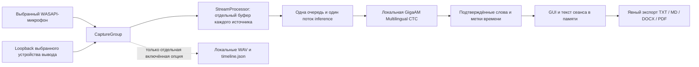

# Устройство приложения

Приложение получает звук выбранных устройств Windows и распознаёт его локально. Пользователь уже участвует в звонке через Teams, Zoom, браузер или другое приложение. Подключение к встрече, аккаунты, токены, meeting API, Docker, облачный STT и LLM в этот процесс не входят.

## Поток данных

`contracts.py` задаёт общие типы устройств, аудиоблоков, слов, фрагментов и событий. `audio.py` отвечает за WASAPI, `streaming.py` — за окна и ограничение памяти, `engine.py` — за модель, `session.py` — за жизненный цикл сеанса. `gui.py` получает события через очередь; загрузка модели, операции драйвера, inference и экспорт не выполняются в обработчике кнопки Tk.

## Захват и часы

Микрофон и системный звук сохраняют собственные буферы и частоты дискретизации. Каналы одного устройства сводятся в mono, но два источника друг с другом не смешиваются. Native WASAPI loopback получает все звуки выбранного устройства вывода; захват отдельного процесса отсутствует.

Каждый блок содержит время первого сэмпла относительно начала сеанса. CaptureGroup сопоставляет часы PortAudio с монотонными часами приложения. Паузы, отключения и пропуски сохраняют временные разрывы; они не превращаются в непрерывную фразу. Повторные и устаревшие блоки не добавляются повторно. Большие расхождения часов и ошибки драйвера останавливают захват явно.

При отключении устройства приложение не переключается на другое или на новый default. Пользователь обновляет список и заново подтверждает выбор. Открытие GUI и перечисление устройств не открывают аудиопотоки. Кнопка проверки уровней — отдельный явный трёхсекундный захват.

## Окна распознавания

Для каждого источника окно содержит до 8 секунд PCM; после первого окна 1 секунда внутри этого объёма — контекст предыдущего окна. Одна половина перекрытия принадлежит предыдущему фрагменту, вторая — следующему. Слово выбирается по середине его меток времени. Это уменьшает повреждение слов на границах и не удаляет реальные повторы вроде «да да» по текстовому совпадению.

Метки модели могут смещаться между окнами примерно на четверть секунды. Защита стыка использует полный предыдущий контекст, включая ещё не опубликованные слова: сопоставляет точные токены по порядку и времени один к одному. Общий сдвиг до 0,4 секунды принимается только при согласованных метках минимум двух разных токенов. Уже подтверждённое совпадение не публикуется повторно; совпадение с неподтверждённым словом остаётся самостоятельным кандидатом. Это сохраняет реальный соседний повтор, вместо удаления одинакового текста.

Для одиночного или неоднозначного совпадения действует более строгая защита: одинаковые слова должны пересечься более чем на 65% длины более длинного интервала. Сопоставление включается только при фактическом перекрытии PCM-окон одного источника. После новой фразы или ручного flush без перекрытия даже немедленный повтор сохраняется. Хранится ограниченный контекст до 128 слов на источник; после stop он очищается. Корректность каждой границы реальной речи всё равно требует проверки на речи, а не только синтетических тестов.

Тишина длительностью примерно 1,2 секунды завершает короткий фрагмент по времени PCM. WASAPI loopback может перестать присылать callback, когда воспроизведение заканчивается: отдельный монотонный idle-таймер завершает оставшийся частичный буфер после примерно 1,2 секунды без принятых блоков. Это не классификация отключённого устройства. Если inference уже занята, окно будет завершено после ранее принятой работы.

Ненулевой тихий звук сохраняется; только точная цифровая тишина перед началом фрагмента не отправляется в модель. Пауза и остановка завершают оставшиеся буферы. После каждого завершённого окна worker обновляет размер очереди, поэтому GUI показывает остаток 0 даже без нового callback. Задержка текста включает накопление окна и время CPU-inference; это не пословный streaming-декодер.

## Ограничение нагрузки

`StreamProcessor.feed()` не ждёт выполнения модели или освобождения места. Одна фоновая очередь выполняет inference последовательно для обоих источников. По умолчанию бюджет составляет 48 секунд PCM и включает активное окно, очередь, буферы обоих источников и контекст перекрытия. Переполнение видно пользователю: новые блоки пропускаются, следующий принятый блок отделяется разрывом. Продолжать такую запись без исправления нагрузки означает терять звук.

Очереди захвата и необязательного писателя WAV ограничены отдельно. Аудиосостояние не растёт с длительностью сеанса. Текст сеанса намеренно остаётся в памяти и растёт; многочасовой GUI-сеанс требует отдельной проверки памяти и производительности. `stop()` сначала прекращает захват, затем обрабатывает уже принятый звук и закрывает ресурсы. Полученный текст остаётся доступным для экспорта.

Ошибки устройства, повреждённые блоки, неверные часы и ошибки inference сообщаются безопасными сообщениями без текста разговора. Сам StreamProcessor умеет обработать следующее окно после ошибки; координатор GUI завершает сеанс при ошибке inference или повреждённых данных, чтобы не скрывать потерянные фрагменты. Автоматического повторного включения записи нет.

## Модель

Используется тот же native CPU-путь, что и в проверенном приложении с микрофоном: `ai-sage/GigaAM-Multilingual`, 220M CTC, float32, greedy decoding с метками слов. Один multilingual-декодер работает с казахским, русским и английским; язык не навязывается отдельной настройкой.

Inference выполняется только через CPU-сборки Torch/Torchaudio и native Conformer/CTC. ONNX и ONNXRuntime не используются. Frozen spec исключает `onnx`, `onnxruntime`, `ml_dtypes`, `gigaam.onnx_utils` и `gigaam.vad_utils`; ONNX-конвертация и дополнительные VAD-модели не нужны этому пути. Проверка готового EXE должна дополнительно подтвердить отсутствие соответствующих модулей и native DLL в архиве.

| Компонент | Зафиксированное значение |
| --- | --- |
| Ревизия модели | `2f8a57144e6ec3adfd32fe0484d9ea9913305bc8` |
| Ревизия native-кода | `7447938d791c4f3e643386ee22c33777004293a5` |
| SHA256 `config.json` | `c830232c7d51688a630a221517b52585ab5ee57e1d3c21bcbae01759351d2653` |
| SHA256 `pytorch_model.bin` | `e1db43873ec5e296f229572e06e2470fc157ac9f8d4aacabda295630b9b91728` |

Файлы читаются из `models/gigaam` рядом с EXE, в исходниках — из корня проекта. SHA256 проверяется до загрузки. Конфигурация имеет allowlist native-компонентов; веса загружаются с `weights_only=True`, без выполнения стороннего Python из model hub. Ресэмплинг и inference выполняются в памяти. Удалённая загрузка модели, FFmpeg и временные WAV с разговором не используются. При отсутствии модели приложение сообщает ошибку.

В сборочном окружении ONNX/ONNXRuntime и soundfile могут быть установлены как закреплённые зависимости upstream GigaAM. Их acquisition-записи и лицензии остаются в расширенном inventory для прозрачности, но наличие такой записи не означает импорт или включение компонента в готовое приложение. Состав runtime определяется frozen manifest и аудитом бинарных зависимостей; подробности в [BUILD.md](BUILD.md).

## Границы возможностей

«Микрофон» и «Звук компьютера» — источники, а не определённые люди. В системном звуке могут одновременно находиться несколько участников. Диаризации и полноценного acoustic echo cancellation нет. При громкоговорителях микрофон может повторно услышать системный звук; для проверки двух источников лучше использовать наушники. Между источниками автоматически удалять совпавшие слова нельзя: это могло бы удалить самостоятельную реальную речь.

Предыдущий удачный тест приложения с микрофоном подтверждает работоспособность выбранной модели, но не качество нового loopback-пути, микрофона вместе с loopback, долгого сеанса, казахской/английской или смешанной речи. Эти проверки выполняются пользователем отдельно. Программа не меняет защиту Windows, правила организации или параметры встречи.

Описание локальных данных и сетевой защиты: [PRIVACY.md](PRIVACY.md). Протокол проверок: [TESTING.md](TESTING.md).
